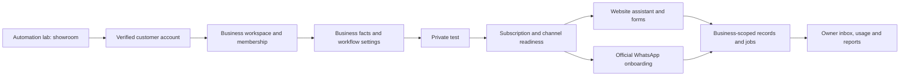

# TriumphantTech self-service platform

The automation lab is the showroom. The customer product is a separate workspace
at `/platform`. Outreach starts only after the launch gates below pass. A dashboard
or a Meta approval alone is not a finished self-service product.

## First release

One business per verified customer account; standard FAQ, enquiry and appointment
workflows. Customers configure their business, approved answers and availability,
test the experience, connect eligible channels and choose a subscription in NGN.
Website design remains an optional agency project, not an included subscription.
Arbitrary workflow builders, banking, payroll, inventory and voice are excluded.

Reuse one maintained application. Scope every customer query to a membership
checked on the server. Never reuse the agency owner's cookie as client identity.
Never route client records through the existing unscoped agency tables or Sheet.
Keep private client activity out of marketing analytics and session replay.

## Proposed NGN commercial model

These are editable launch proposals, not validated margins or activated charges.
Amounts are stored as integer kobo. No annual commitment or automatic overages.

| Plan     |    Monthly | Included assistant replies | FAQs | Channels                                    |
| -------- | ---------: | -------------------------: | ---: | ------------------------------------------- |
| Starter  | NGN 15,000 |                        500 |   20 | Website; one WhatsApp number when connected |
| Growth   | NGN 35,000 |                      2,000 |   60 | Same channels; higher usage                 |
| Business | NGN 75,000 |                      5,000 |  150 | Same channels; higher usage                 |

One assistant reply means one completed automated answer, not a Meta billing unit.
Meta/provider message charges must be explained and charged separately or covered
by a funded, explicitly capped allowance before WhatsApp billing is enabled.
Human replies, delivery receipts and retries must not inflate reply usage.
Failed provider calls are tracked separately. Limits stop usage; they do not
silently charge more. Prices require tax, fee, exchange-rate and support-cost
review before publication. Custom setup/import and website work are separate quotes.

## Architecture

The existing Next.js/Hono/D1 stack is retained. Authentication uses Better Auth;
email OTP verifies the address before account creation. Auth tables are separate
from the agency owner login. The signed gateway binds session context to the RPC
body. Client-supplied user IDs, membership roles and subscription status are ignored.
Prices, quotas and activation are server-owned. Public APIs expose only published
business information and never owner sessions, email addresses or private leads.

## Launch gates and evidence required

- [ ] Verified signup, login, logout, expiry, rate limits and recovery tested.
- [ ] Two unrelated businesses cannot read, edit, reserve or export each other's records.
- [ ] Profile/FAQ changes persist and the assistant uses only that business's facts.
- [ ] Real enquiry capture, booking conflicts, cancellation and human handoff tested.
- [ ] Website installation works on an unrelated customer's domain.
- [ ] Meta app access approved; Embedded Signup, number eligibility/coexistence,
      signature verification, replay handling, templates, STOP and human pause tested.
- [ ] NGN plans reviewed against measured costs; exact limits enforced atomically.
- [ ] Live billing, signed/reverified webhooks, renewal, cancellation, failed payment,
      entitlement expiry and duplicate notifications tested without duplicate charges.
- [ ] Tenant credentials protected, rotated and excluded from logs and exports.
- [ ] Delivery retries, incident alerts, backup/restore and data export/deletion tested.
- [ ] Customer terms, privacy, subprocessors, support and refund process reviewed.
- [ ] New customer completes onboarding without developer/dashboard assistance.

Do not mark these complete from a page rendering, a test checkout, a simulated
connection or a successful code deployment. Record actual evidence per gate.

## Delivery order

1. Verified identity, workspaces, isolation, saved business configuration and draft plans.
2. Tenant-specific assistant, enquiry inbox and booking workflow, with private testing.
3. Website publication/installation, usage accounting and operational controls.
4. Official Meta onboarding, tenant credential storage and actual channel transport.
5. NGN subscriptions and lifecycle, then full launch acceptance and release.

Meta-dependent work is developed behind explicit readiness checks while approval
is pending. Do not accept money for a channel that is not available.

## Next increment: guided setup and conversation rehearsal

Migration 0009 adds business-scoped responder settings and private practice
conversations. The Setup tab derives progress from saved profile/answers,
explicitly saved responder settings and a stored test message. It does not mark
WhatsApp or billing ready. Default appointment hours must still be reviewed.

Autoresponders support welcome, outside-hours and unknown-answer messages.
Conversation rehearsal uses saved FAQs and Lagos booking hours, without an AI
call or outbound delivery. Each business may store up to 100 test conversations;
each has a bounded message history. Manual team replies and customer STOP/human
requests pause automation. Only an authenticated workspace member may resume it.
Owners alone edit responder settings; workspace members can rehearse replies.
Version checks prevent stale replies/settings overwrites, and message request IDs
make retries idempotent. These records never become agency leads or outbound jobs.

This is a rehearsal inbox, not a connected WhatsApp inbox: there are no live
delivery receipts, unread state, attachments or customer number connection yet.
Rehearsal mutations are blocked in production. Migration 0009 must be applied
before deploying this increment to any enabled environment. Production platform
access remains gated. Live transport, billing and operational acceptance remain
separate release requirements.

## Implementation status: 20 October 2026

### AI-assisted matching and website widget increment

Migrations 0010/0011 add opt-in AI matching, durable inference admission and a
website origin setting. AI selects approved FAQ IDs; the server renders the
approved text. It is not free-form answer generation. Exact matches avoid the
provider. Only the latest question and the current business's approved FAQs enter
inference; owner records and conversation history do not. Unknown/invalid results
or provider failures use the business fallback and pause private rehearsal for a
team member. Outside-hours rehearsal replies remain deterministic.

Inference requires the staging PLATFORM_AI_ENABLED flag, an AI binding and the
owner's saved opt-in. Reservations cap attempts at 100 per business per Lagos
month and 500 across the platform per Lagos day. A durable request/digest claim
prevents duplicate inference; provider retries are disabled. Interrupted claims
are not sent again. Stored telemetry contains selected IDs and token counts,
not raw prompts. Cache retention/export/deletion remain operational launch work.

The Website tab produces an iframe snippet after an owner enables one HTTPS
origin for a published sandbox page. The widget route uses a server-generated
frame-ancestors policy and fails closed if settings/publication cannot be checked.
Private workspace pages reject framing. Pausing publication blocks new public
submissions. These settings are an embed allowlist, not proof of domain ownership.
Vercel preview protection can prevent cross-site iframe loading: installation on
an unrelated website must be accepted separately. A signed staging API test on
21 October selected the synthetic business's approved hours answer using the
real model and returned the cached result on retry. Two earlier questions handed
off; explicit paraphrase guidance was added before the successful check. This is
one live acceptance example, not a broad model quality evaluation. Deployed
widget headers returned HTTP 200 with frame-ancestors https://example.test for a
reserved-domain synthetic fixture. Owner UI and unrelated-site acceptance for
these new controls are still required. Synthetic fixture AI/embed access is
disabled again after the checks.
No production platform activation, live WhatsApp transport or charges are enabled.

The existing model was verified against [Cloudflare's model documentation](https://developers.cloudflare.com/workers-ai/models/qwen3-30b-a3b-fp8/).

Built: passwordless verified accounts; one private business workspace per account;
owner/staff authorization; profile, FAQ and Lagos booking-rule editors; draft NGN
plan selection; private FAQ testing; a sandbox customer page; business-scoped
enquiry/appointment inbox; enquiry status changes; atomic reservations and private
cancellation codes. Publication and pausing require the actual business owner.

The sandbox page is `/business/<workspace-id>`. It is explicitly a test page.
Customers can ask about approved facts, store a test enquiry, reserve a test
appointment and cancel it with their code. Pausing the page blocks new submissions
but cancellation remains available at `/business/<workspace-id>/manage`.
No email, WhatsApp or SMS jobs are created by these sandbox workflows. Records do
not enter TriumphantTech's agency lead tables, booking tables or Google Sheet.
Paid plans and WhatsApp are not active. FAQ matching is deterministic, not an AI
conversation; the existing agency Workers AI demo is not claimed as client AI.

Sandbox allowances are 100 completed replies, 100 enquiries and 100 bookings per
business per month. Stored reply request IDs prevent duplicate usage accounting;
different content cannot reuse an existing reference. A single bounded request
can save all 150 Business-plan answers, including multibyte text, using four SQL
statements in one transaction. The regular agency API body limit is unchanged.

The owner authorized one sign-in email to their test address and completed
verification. A real browser created a labelled staging business, saved its
profile/FAQ/booking policy, returned its saved FAQ answer, selected a draft NGN
plan and confirmed profile and booking-policy persistence after reload. No charge
was attempted. The new customer-page/inbox browser acceptance remains a separate
check; passing backend tests does not prove that full UI journey.

Production remains disabled with `PLATFORM_ENABLED=false`. Staging is enabled.
Apply migrations 0007 and 0008 before enabling the platform. The old agency
workflows remain separate. Backend tests cover two-business isolation, staff
restrictions, stale edits, a full answer set, public data minimization, enquiry
retries, booking concurrency, changed buffers, cancellation after pausing and
non-inflating usage. Website gateway tests cover Origin, size limits, trusted
identity forwarding, signed transport and HttpOnly cookie handling.

Still required before outreach: verified customer AI if sold as AI; delivery jobs
and real notification tests; installation on an unrelated website; billing and
entitlement lifecycle; Meta onboarding/transport; usage/cost instrumentation;
backup/restore, exports/deletion, monitoring and a customer completing onboarding
without developer assistance. This implementation is not a launch-ready claim.

## Pricing arithmetic, not a margin guarantee

### Subscription rehearsal increment: 21 October 2026

Migration 0012 adds isolated test billing accounts and a verified-payment ledger.
The Plans tab now has a separate subscription rehearsal panel. Draft plan
selection remains free and does not start billing. Checkout requires owner
membership, explicit recurring consent, a server-owned price and a verified
monthly NGN Paystack test plan. Customer email comes from the verified account.

Only staging with `PLATFORM_BILLING_TEST_ENABLED=true` and a `sk_test_` key can
call the billing provider. Both checked-in environments default the billing flag
off. `PLATFORM_BILLING_TEST_EMAIL` restricts checkout and management to the approved
verified test account; other accounts cannot start provider operations.
Migration 0013 holds the operator-provisioned test plan catalog. A signed
operator endpoint at `/v1/platform/billing/test-plans` creates the three plans
with durable one-time reservations; it is absent from the website RPC allowlist.
`PLATFORM_PAYSTACK_TEST_PLANS` optionally overrides the catalog with an approved
JSON mapping. Every checkout still verifies the provider's price and interval.
Never configure a live key here.

A durable checkout reservation prevents retries from starting another native
subscription. If initialization has an unknown result, the reservation remains
for reconciliation; it is not silently deleted or charged again. This currently
needs operator recovery if no checkout URL can be recovered. Only one billing
attempt/subscription per business is supported in this increment; plan changes
and resubscription after cancellation are not available yet.

The existing raw-body-verified Paystack webhook also handles platform events in
enabled staging. Initial charges and renewals are reverified through Paystack's
API against reference, customer, test mode, currency, amount and plan/period.
Payment insertion and paid-through updates commit together. Duplicate and old
notifications cannot add time or shorten a newer paid period. Subscription
events reconcile current provider state instead of trusting event order.
Owner refresh can recover a missing subscription-create callback using the
verified customer/plan IDs and a bounded provider lookup. Ambiguous matching
subscriptions stop for review. The existing account-wide webhook URL is not
changed for the staging test; automatic staging callback delivery is therefore
not yet accepted.
Cancellation intent is saved before calling Paystack; provider failure leaves
an honest cancel-pending state for retry. Confirmed cancellation retains already
paid time. Failed renewal does not extend access; expiry is evaluated at read
time even without a scheduled job.

This is test billing, not production entitlement enforcement. Its paid test
period does not change sandbox allowances, enable WhatsApp or open production.
No card data, reusable authorization or subscription management token is stored.
Live-key support, refunds/disputes, upgrades/downgrades, payment recovery,
scheduled reconciliation and customer notification acceptance remain launch
requirements. Test checkout and cancellation acceptance is recorded below.
On 21 October, the approved account prepared one Starter checkout through the
workspace. Paystack displayed TEST and NGN 15,000, then Payment Successful.
Workspace refresh verified the payment and recovered the native subscription.
The owner-authorized cancellation was submitted, then refreshed against Paystack.
D1 confirmed one verified payment, an attached provider subscription,
cancel_requested=1 and state=non-renewing, preserving paid-through
2026-11-21T20:33:00.000Z. No real money was charged. Full renewal/failure events
remain mocked acceptance; real automatic staging webhook delivery is not proven.
All 77 Worker tests, frontend/Worker TypeScript, targeted ESLint and the preview
build passed before the final cancellation-label refinement.

Provider contracts checked against [Paystack subscriptions](https://paystack.com/docs/payments/subscriptions/),
[subscription API](https://paystack.com/docs/api/subscription/) and
[transaction verification](https://paystack.com/docs/api/transaction/#verify).

Checked on 20 October 2026: Paystack lists Nigerian local transaction fees of
1.5% plus NGN 100, capped at NGN 2,000. The small-transaction waiver does not apply
to these proposed plan amounts. These figures exclude other operating costs and
tax handling. [Paystack transaction pricing](https://support.paystack.com/en/articles/2130306).

| Plan     | Proposed charge | Local collection fee | Balance before other costs |
| -------- | --------------: | -------------------: | -------------------------: |
| Starter  |      NGN 15,000 |              NGN 325 |                 NGN 14,675 |
| Growth   |      NGN 35,000 |              NGN 625 |                 NGN 34,375 |
| Business |      NGN 75,000 |            NGN 1,225 |                 NGN 73,775 |

Cloudflare lists Qwen3 30B A3B FP8 at USD 0.0509 per million input tokens and
USD 0.335 per million output tokens. At an illustrative 2,000 input and 160 output
tokens per call, a model call is USD 0.0001554; 500/2,000/5,000 calls would be
USD 0.0777/0.3108/0.777 respectively. Multiply by the actual billed NGN/USD rate;
no exchange rate is assumed here. Actual prompts, retries and provider usage
must be measured. This is model inference alone, not the total service cost, and
the current client FAQ workflow does not call a model.
[Cloudflare model pricing](https://developers.cloudflare.com/ai/models/%40cf/qwen/qwen3-30b-a3b-fp8/).

Budget separately for hosting/database, email, support time, payment losses,
Meta messages and provider billing. Do not sell unlimited support or messaging.

### Staging API acceptance

Staging Worker version `8f6c2f4c-b6ea-41d4-9a64-7782f13501f0` has migrations
0007/0008. A separate, clearly synthetic database fixture has no usable login
session and uses a reserved `example.test` address. It was seeded directly for
API acceptance; this is not evidence of the owner publication UI working.
Signed API checks verified public fact minimization, a saved approved answer,
cached answer/enquiry retries, a stored appointment, retry reuse, removal of the
taken slot, cancellation, duplicate cancellation and restoration of availability.
No customer messages or charges were created. All 64 Worker tests and 14 website
tests passed, including a Lagos midnight monthly-allowance regression check.
The deployed Vercel preview loaded the synthetic business, returned its approved
FAQ answer and saved an enquiry and appointment. Edge then stopped responding;
the synthetic appointment was cancelled directly in staging D1, where both test
appointments are now cancelled. Browser cancellation and owner inbox/publication
checks remain pending. API cancellation and slot restoration passed separately.
Switching customer workflows now clears consent and challenge state, appointment
loading is explicit, and booking requests omit the prior enquiry text. These
latest UI refinements still need a responsive visual check in a working browser.

### Team access increment (22 October 2026)

Migration 0014 adds email-bound, seven-day staff invitations. Only the workspace
owner can list team details, invite, withdraw invitations or remove staff. An
invitation grants access only after its recipient signs in with the matching
verified email and accepts. Roles are assigned by the server; client input cannot
grant ownership. Membership is checked on each business request, so removal also
blocks an existing signed-in session from future business requests.

The first release supports ten members including the owner, with pending
invitations reserving capacity. Staff can use the inbox and conversation rehearsal;
business configuration, billing and team administration remain owner-only. Users
can switch between their own workspace and businesses they have joined.
Invitations are manually shared from the owner panel; no invitation email is sent.
Ownership transfer, custom roles and team audit history are not implemented.

All 79 Worker tests passed, including recipient matching, role forgery, concurrent
capacity, expiry, withdrawal, business isolation and access removal. Browser
acceptance with a separate verified staff account completed on 22 October: the
approved recipient signed in, accepted the invitation, and opened the business
inbox and existing conversation rehearsal. Only Inbox and Conversations appeared
in its navigation. D1 confirmed the membership role was staff. The temporary
membership and invitation were revoked through scoped operator D1 commands while
the staff browser session remained signed in. Its next conversation-list request
was denied with "Workspace not found." This verifies membership enforcement for
an existing session. On 23 October, the approved test membership was briefly
restored as an operator fixture and the signed-in owner used Remove staff access.
The UI confirmed removal and returned to one owner, closing the owner-button
browser acceptance check. No messages were sent and no staff membership remains.
The signed-in owner browser created a reserved `example.test` invitation, displayed
manual sharing instructions, and withdrew it successfully on 22 October. The Team
screen returned to one owner and no pending invitations; no invitation email was
sent. The synthetic widget was disabled and its reserved origin restored after
the independent website checks.

Independent website acceptance on 22 October stored an enquiry, reserved and
cancelled an appointment, and confirmed both records in the synthetic business's
database. The management page fits at 390 pixels. The exact lazy-loaded iframe
answered the approved question on the separate allowed host; a second, unapproved
origin was refused. This supersedes the older pending embedded-cancellation check
above. Production activation and real WhatsApp onboarding remain separate gates.

### Platform operations overview

`/admin/platform` reuses the existing private agency owner session. It calls only
the signed internal `/v1/admin/platform` endpoint; customer workspace sessions do
not grant operator access, and the customer RPC has no overview action. The page
is read-only and excludes account email addresses, customer contact details,
message bodies, cancellation codes, provider identifiers and authentication data.

The overview shows global business totals, state filters and twenty businesses
per page using an ID cursor. Each card shows team counts, current Lagos-month
sandbox replies, all-time enquiry/confirmed-appointment/rehearsal counts, business
widget/AI flags and stored TEST billing state. Global controls are configuration
flags, not provider-health checks. Published means a sandbox business page; it
does not mean an approved WhatsApp connection. Paid test periods do not grant
live production access. No suspension, plan changes or billing actions are offered.

The endpoint refuses requests when the platform is disabled, before reading its
tables. No migration is needed beyond the existing platform schema through 0014.
All 80 Worker tests and 15 website tests passed, including pagination without
duplicates, Lagos month rollover, private-data exclusion, invalid-filter rejection,
disabled-platform refusal and blocked operator actions at the customer gateway.

Staging acceptance on 23 October: the private owner login opened the overview
and displayed both existing businesses, including zero staff memberships after
cleanup. The published filter returned the one published synthetic business;
the suspended filter showed the explicit empty result. At 390 pixels wide,
business cards and labels remained readable with no horizontal page overflow.
The viewport override was reset after inspection. The staging endpoint returned
401 unsigned and 200 with the internal signature. Vercel build/TypeScript and
targeted lint passed. No production activation was performed.

The owner-admin password differs from the invoice admin password. For this
acceptance, the owner privately configured a new `ADMIN_LAB_PASSWORD_HASH` scoped
only to `codex/platform-operator-overview` in Vercel Preview. It was applied by a
preview redeployment; no password or hash is stored in this document. Production
operator access must be configured independently before that environment opens.

## WhatsApp staging onboarding increment

Official Meta Embedded Signup is **v5** (released 20 October 2026). v2/v3 were
deprecated on 15 October 2026. Access Verification is retired; App Review is
still required for Advanced Access. This increment does not submit App Review
and does not claim Advanced Access.

Staging can onboard a tester number:

- Launch tab starts Embedded Signup v5 (`extras.version: "v5"`, Cloud API only).
  WhatsApp Business app coexistence stays on, which is required for
  `+234 909 009 0910`.
- The Worker exchanges the 30-second code server-side, encrypts the business
  token per workspace, and subscribes the Messaging account with
  `override_callback_uri` so `messages` do not use the app’s default callback.
- `POST/GET /webhooks/whatsapp` on the automation Worker verifies Meta
  signatures and routes only by stored `phone_number_id`. Unknown numbers and
  the protected UK campaign ID `1092109073976406` are ignored.
- Live inbox threads are separate from rehearsal conversations. Approved FAQ
  answers can reply; STOP/HUMAN/team replies pause automation.
- `PLATFORM_WHATSAPP_ENABLED` is false in production and staging wrangler
  vars. Enabling staging still requires Meta app ID/secret, Facebook Login
  configuration ID, verify token, webhook URL and a 32-byte token key. Apply
  migration 0015 before enabling.
- The existing `triumphanthq-whatsapp-bot` Worker, its webhook and
  `whatsapp-bot-prod` are unchanged. Do not point Digital Forge 2’s default
  callback at this new path.

Public website env names: `NEXT_PUBLIC_META_APP_ID`,
`NEXT_PUBLIC_META_ES_CONFIG_ID`, `NEXT_PUBLIC_META_GRAPH_VERSION` (v26.0).
Worker secret names: `META_APP_ID`, `META_APP_SECRET`,
`PLATFORM_WA_VERIFY_TOKEN`, `PLATFORM_WA_WEBHOOK_URL`,
`PLATFORM_WA_TOKEN_KEY`. Values are not recorded here.

A rehearsal or a successful code deploy is not live delivery. Genuine evidence
is still: inbound webhook for the connected number, tenant-scoped approved
reply, Graph acceptance, and the message on the handset. External-customer
signup waits on Advanced Access.
