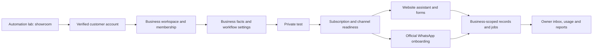

# TriumphantTech self-service platform

The automation lab is the showroom. The customer product is a separate workspace
at `/platform`. Outreach starts only after the launch gates below pass. A dashboard
or a Meta approval alone is not a finished self-service product.

## First release

One business per verified customer account; standard FAQ, enquiry and appointment
workflows. Customers configure their business, approved answers and availability,
test the experience, connect eligible channels and choose a subscription in NGN.
Website design remains an optional agency project, not an included subscription.
Arbitrary workflow builders, banking, payroll, inventory and voice are excluded.

Reuse one maintained application. Scope every customer query to a membership
checked on the server. Never reuse the agency owner's cookie as client identity.
Never route client records through the existing unscoped agency tables or Sheet.
Keep private client activity out of marketing analytics and session replay.

## Proposed NGN commercial model

These are editable launch proposals, not validated margins or activated charges.
Amounts are stored as integer kobo. No annual commitment or automatic overages.

| Plan     |    Monthly | Included assistant replies | FAQs | Channels                                    |
| -------- | ---------: | -------------------------: | ---: | ------------------------------------------- |
| Starter  | NGN 15,000 |                        500 |   20 | Website; one WhatsApp number when connected |
| Growth   | NGN 35,000 |                      2,000 |   60 | Same channels; higher usage                 |
| Business | NGN 75,000 |                      5,000 |  150 | Same channels; higher usage                 |

One assistant reply means one completed automated answer, not a Meta billing unit.
Meta/provider message charges must be explained and charged separately or covered
by a funded, explicitly capped allowance before WhatsApp billing is enabled.
Human replies, delivery receipts and retries must not inflate reply usage.
Failed provider calls are tracked separately. Limits stop usage; they do not
silently charge more. Prices require tax, fee, exchange-rate and support-cost
review before publication. Custom setup/import and website work are separate quotes.

## Architecture

The existing Next.js/Hono/D1 stack is retained. Authentication uses Better Auth;
email OTP verifies the address before account creation. Auth tables are separate
from the agency owner login. The signed gateway binds session context to the RPC
body. Client-supplied user IDs, membership roles and subscription status are ignored.
Prices, quotas and activation are server-owned. Public APIs expose only published
business information and never owner sessions, email addresses or private leads.

## Launch gates and evidence required

- [ ] Verified signup, login, logout, expiry, rate limits and recovery tested.
- [ ] Two unrelated businesses cannot read, edit, reserve or export each other's records.
- [ ] Profile/FAQ changes persist and the assistant uses only that business's facts.
- [ ] Real enquiry capture, booking conflicts, cancellation and human handoff tested.
- [ ] Website installation works on an unrelated customer's domain.
- [ ] Meta app access approved; Embedded Signup, number eligibility/coexistence,
      signature verification, replay handling, templates, STOP and human pause tested.
- [ ] NGN plans reviewed against measured costs; exact limits enforced atomically.
- [ ] Live billing, signed/reverified webhooks, renewal, cancellation, failed payment,
      entitlement expiry and duplicate notifications tested without duplicate charges.
- [ ] Tenant credentials protected, rotated and excluded from logs and exports.
- [ ] Delivery retries, incident alerts, backup/restore and data export/deletion tested.
- [ ] Customer terms, privacy, subprocessors, support and refund process reviewed.
- [ ] New customer completes onboarding without developer/dashboard assistance.

Do not mark these complete from a page rendering, a test checkout, a simulated
connection or a successful code deployment. Record actual evidence per gate.

## Delivery order

1. Verified identity, workspaces, isolation, saved business configuration and draft plans.
2. Tenant-specific assistant, enquiry inbox and booking workflow, with private testing.
3. Website publication/installation, usage accounting and operational controls.
4. Official Meta onboarding, tenant credential storage and actual channel transport.
5. NGN subscriptions and lifecycle, then full launch acceptance and release.

Meta-dependent work is developed behind explicit readiness checks while approval
is pending. Do not accept money for a channel that is not available.

## Implementation status: 20 October 2026

Built: passwordless verified accounts; one private business workspace per account;
owner/staff authorization; profile, FAQ and Lagos booking-rule editors; draft NGN
plan selection; private FAQ testing; a sandbox customer page; business-scoped
enquiry/appointment inbox; enquiry status changes; atomic reservations and private
cancellation codes. Publication and pausing require the actual business owner.

The sandbox page is `/business/<workspace-id>`. It is explicitly a test page.
Customers can ask about approved facts, store a test enquiry, reserve a test
appointment and cancel it with their code. Pausing the page blocks new submissions
but cancellation remains available at `/business/<workspace-id>/manage`.
No email, WhatsApp or SMS jobs are created by these sandbox workflows. Records do
not enter TriumphantTech's agency lead tables, booking tables or Google Sheet.
Paid plans and WhatsApp are not active. FAQ matching is deterministic, not an AI
conversation; the existing agency Workers AI demo is not claimed as client AI.

Sandbox allowances are 100 completed replies, 100 enquiries and 100 bookings per
business per month. Stored reply request IDs prevent duplicate usage accounting;
different content cannot reuse an existing reference. A single bounded request
can save all 150 Business-plan answers, including multibyte text, using four SQL
statements in one transaction. The regular agency API body limit is unchanged.

The owner authorized one sign-in email to their test address and completed
verification. A real browser created a labelled staging business, saved its
profile/FAQ/booking policy, returned its saved FAQ answer, selected a draft NGN
plan and confirmed profile and booking-policy persistence after reload. No charge
was attempted. The new customer-page/inbox browser acceptance remains a separate
check; passing backend tests does not prove that full UI journey.

Production remains disabled with `PLATFORM_ENABLED=false`. Staging is enabled.
Apply migrations 0007 and 0008 before enabling the platform. The old agency
workflows remain separate. Backend tests cover two-business isolation, staff
restrictions, stale edits, a full answer set, public data minimization, enquiry
retries, booking concurrency, changed buffers, cancellation after pausing and
non-inflating usage. Website gateway tests cover Origin, size limits, trusted
identity forwarding, signed transport and HttpOnly cookie handling.

Still required before outreach: verified customer AI if sold as AI; delivery jobs
and real notification tests; installation on an unrelated website; billing and
entitlement lifecycle; Meta onboarding/transport; usage/cost instrumentation;
backup/restore, exports/deletion, monitoring and a customer completing onboarding
without developer assistance. This implementation is not a launch-ready claim.

## Pricing arithmetic, not a margin guarantee

Checked on 20 October 2026: Paystack lists Nigerian local transaction fees of
1.5% plus NGN 100, capped at NGN 2,000. The small-transaction waiver does not apply
to these proposed plan amounts. These figures exclude other operating costs and
tax handling. [Paystack transaction pricing](https://support.paystack.com/en/articles/2130306).

| Plan     | Proposed charge | Local collection fee | Balance before other costs |
| -------- | --------------: | -------------------: | -------------------------: |
| Starter  |      NGN 15,000 |              NGN 325 |                 NGN 14,675 |
| Growth   |      NGN 35,000 |              NGN 625 |                 NGN 34,375 |
| Business |      NGN 75,000 |            NGN 1,225 |                 NGN 73,775 |

Cloudflare lists Qwen3 30B A3B FP8 at USD 0.0509 per million input tokens and
USD 0.335 per million output tokens. At an illustrative 2,000 input and 160 output
tokens per call, a model call is USD 0.0001554; 500/2,000/5,000 calls would be
USD 0.0777/0.3108/0.777 respectively. Multiply by the actual billed NGN/USD rate;
no exchange rate is assumed here. Actual prompts, retries and provider usage
must be measured. This is model inference alone, not the total service cost, and
the current client FAQ workflow does not call a model.
[Cloudflare model pricing](https://developers.cloudflare.com/ai/models/%40cf/qwen/qwen3-30b-a3b-fp8/).

Budget separately for hosting/database, email, support time, payment losses,
Meta messages and provider billing. Do not sell unlimited support or messaging.

### Staging API acceptance

Staging Worker version `6920d87c-ecbf-4d16-945b-761175980a82` has migrations
0007/0008. A separate, clearly synthetic database fixture has no usable login
session and uses a reserved `example.test` address. It was seeded directly for
API acceptance; this is not evidence of the owner publication UI working.
Signed API checks verified public fact minimization, a saved approved answer,
cached answer/enquiry retries, a stored appointment, retry reuse, removal of the
taken slot, cancellation, duplicate cancellation and restoration of availability.
No customer messages or charges were created. All 63 Worker tests and 14 website
tests passed. TypeScript and targeted frontend ESLint passed. Edge automation
timed out during the next customer-page/inbox UI check; that check remains pending.
